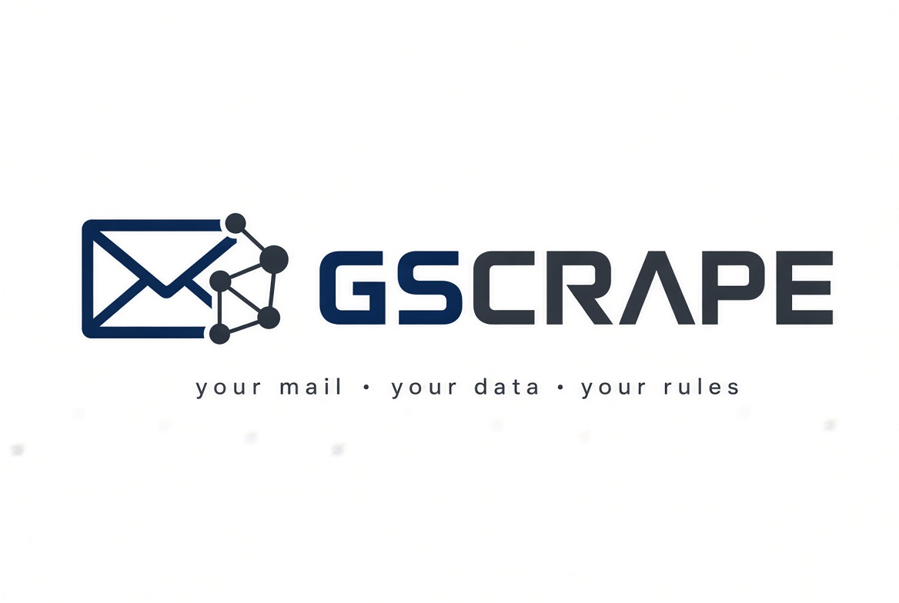
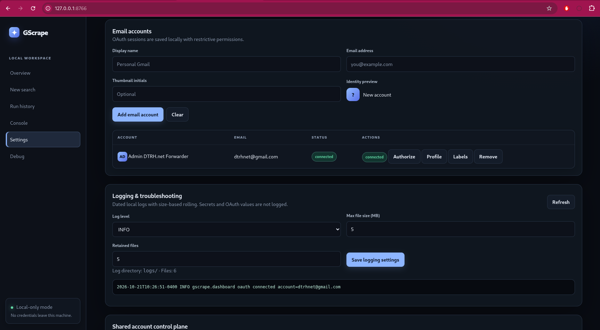
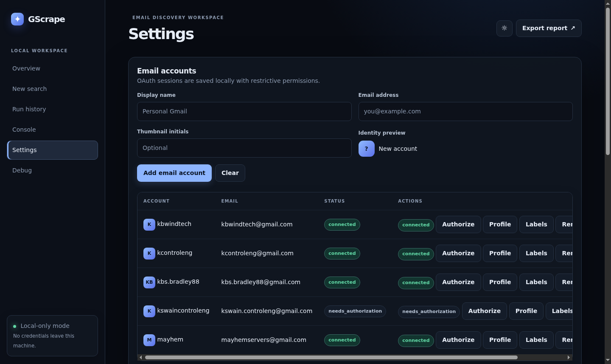
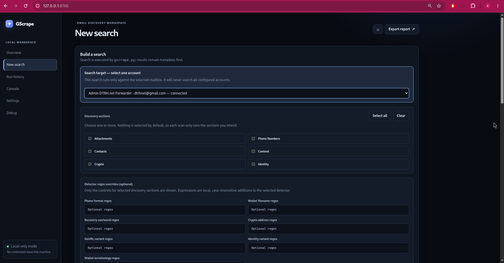
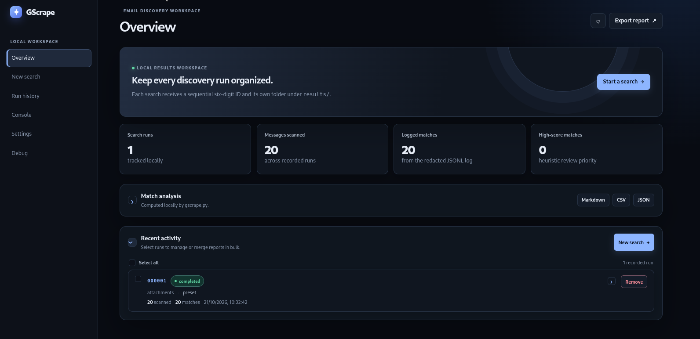
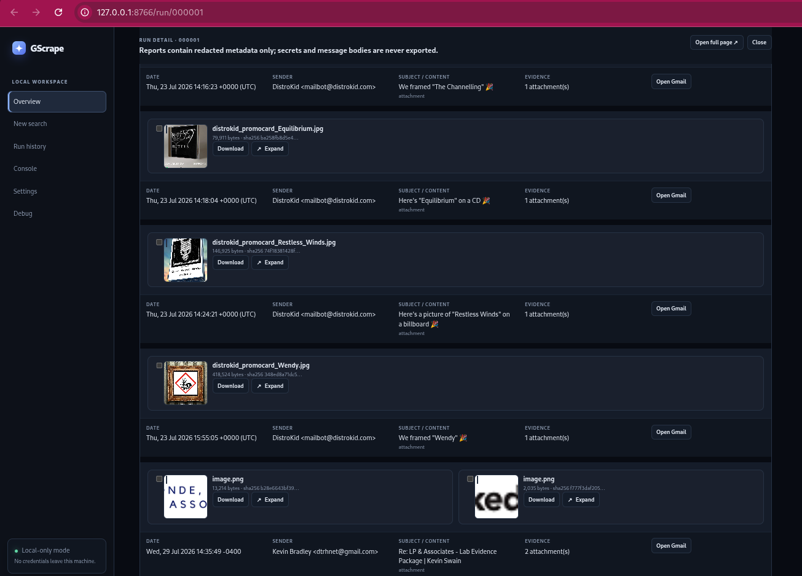
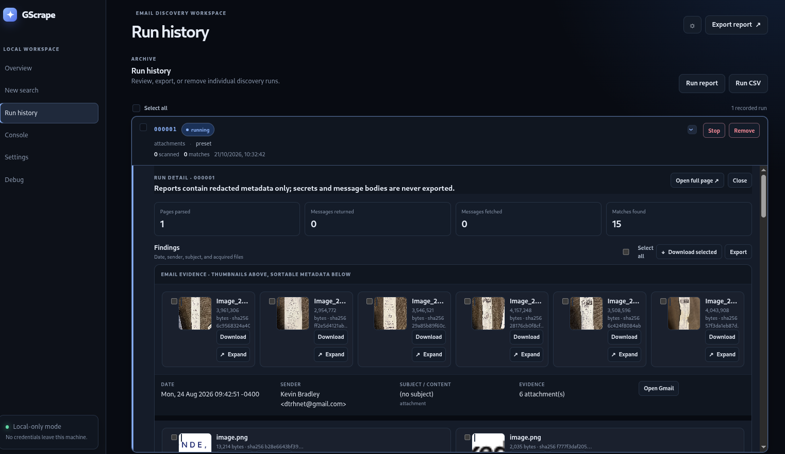
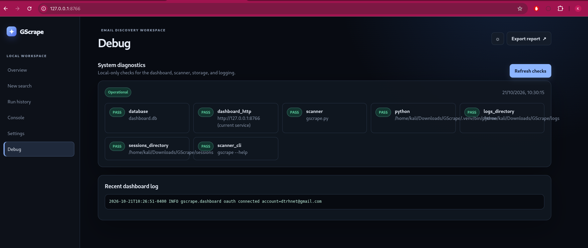

# GScrape

<p align="center">
  
</p>

## Developer note

I originally built GScrape to quickly search through my old email accounts for
cryptocurrency wallets and related records. I was frustrated by browser search
rules, paginated results, and having to open every message individually just to
decide whether it mattered.

As the project grew, I realized it could be useful for much more than crypto.
It became a way to recover old photographs that might otherwise have been lost,
rediscover conversations with people who are no longer here, and revisit some
of the best and most difficult moments of my life. What began as a small Python
script for pulling matching messages turned into a passion project.

I have simplified the workflow considerably. GScrape remains CLI-native, but the
local dashboard makes searching and reviewing large amounts of personal data
much faster. I never originally planned to release it publicly—but here it is.

— KBS <admin@dtrh.net>

<p align="center">
  <strong>Your mail · your data · your rules</strong>
</p>


> Take control of your email. Search it, understand it, and turn years of
> messages into useful personal data — locally, privately, and on your terms.

<p align="center">
  <a href="https://github.com/DTRHnet/GScrape/releases/tag/v1.2.0"></a>
  <a href="https://www.python.org/"></a>
  <a href="https://developers.google.com/gmail/api"></a>
  <a href="#testing"></a>
  <a href="#security-and-data-handling"></a>
</p>

**Version:** `1.2.0` · **Status:** current release · **Deployment:** self-hosted

## Overview

GScrape is a self-hosted toolkit for quickly parsing your own email accounts.
Start with a ready-made preset, refine it with filters and date ranges, or write
your own regular expressions and extraction rules. Use deterministic local
matching when you want predictable results; optionally add an LLM later when
semantic understanding, classification, or summarization is more useful than a
literal pattern.

The current implementation is Gmail-focused and has strong coverage for
cryptocurrency, wallet, recovery, and service evidence. The larger goal is much
broader: make it easy to find the attachment you forgot about, count electronic
transfers over a particular period, reconstruct a subscription history, locate
receipts, understand correspondence, or answer a question about your own data
without handing your entire mailbox to a third party.

GScrape is not a hosted analytics service. It is a personal instrument for
learning from your own records while keeping the account connection, parser,
results, and secrets under your control.

The included local backend uses AES-256-GCM from the pinned `cryptography`
dependency. Ciphertext is stored in a mode-0600 protected-artifact directory;
the master key is stored separately through the local secret store. Protect both
locations and their backups.

## What it is for

- **Find forgotten things:** locate a filename, invoice, receipt, account notice,
  document, or conversation buried in years of email.
- **Measure your activity:** count transfers, payments, subscriptions, invoices,
  or messages within a defined time window.
- **Search with increasing precision:** begin with a preset, add terms and date
  boundaries, then graduate to custom regular expressions and configuration.
- **Understand your archive:** group evidence, rank likely matches, export
  structured results, and build a personal view of your digital history.
- **Choose your analysis mode:** use local deterministic rules, an optional local
  or approved LLM workflow, or both with the rule-based results as a traceable
  baseline.

## Design principles

1. **Your data stays yours.** Self-host the application and choose where its
   database, reports, credentials, and model calls live.
2. **Presets before complexity.** Common tasks should take seconds; advanced
   users can reach the full power of regex and configuration without changing
   tools.
3. **Explainable by default.** Every match should show why it was selected,
   which rule or model produced it, and what scope was searched.
4. **Secrets are useful, not careless.** Personal parsing sometimes requires
   recording sensitive values. Store them locally with appropriate protection,
   display only partially redacted values in the dashboard, and never leak them
   into logs, exports, prompts, or source control.
5. **Discovery is not recovery.** Finding a wallet-related message is evidence
   gathering, not permission to open attachments or attempt password recovery.

## Current scope and roadmap

Today, GScrape provides a Gmail scanner, focused search categories, defensive
MIME parsing, configurable date ranges, explainable scoring, attachment filename
matching, redacted audit records, adaptive API pacing, and a local dashboard.

The dashboard provides bounded inline run details and a full-page run view that
opens in a new tab while retaining the application sidebar. Full-page findings
use image-first, two-row email groups: acquired attachment thumbnails appear in
the top row, with date, sender, subject/content categories, evidence metadata,
and the Gmail link below. Thumbnail galleries expand to use the available page
width, and attachment cards include safe wrapping for filenames and actions.
Each acquired attachment can be selected with a checkbox; use **Select all** and
**Download selected** to batch-download the chosen files. Identical attachments
are deduplicated locally and can be resolved across runs without another
download.

The project is intended to grow toward reusable search and extraction presets,
saved queries, richer personal analytics, provider adapters beyond Gmail, local
model support, and dashboard-specific controls for protected artifacts. The
current build already supports user-defined regex expressions, category regex
overrides, attachment filters, contact filters, redacted reports, and optional
LLM analysis; these are no longer future-only capabilities.

The LLM layer is intentionally optional. A mailbox should remain useful with no
model, no cloud inference, and no external data transfer.

## Requirements

- Python 3.9 or newer.
- An authorized Google Cloud project with the Gmail API enabled.
- OAuth client credentials configured for the local callback URI.
- Gmail readonly scope:
  `https://www.googleapis.com/auth/gmail.readonly`

GScrape uses the Python standard library for most scanner and dashboard
operations, with `cryptography` required for the protected-artifact security
boundary. A virtual environment is recommended.


## Setup

Follow these steps on the machine that will access the authorized mailbox. Keep
the project directory private and do not expose the dashboard to the internet.

### 1. Clone the repository and create an environment

```bash
git clone https://github.com/DTRHnet/GScrape.git
cd GScrape
python3 -m venv .venv
source .venv/bin/activate
cp .env.example .env
```

### 2. Install dependencies

```bash
python -m pip install --upgrade pip
python -m pip install -r requirements.txt
```

### 3. Configure Google Cloud and OAuth

1. Create or select an authorized Google Cloud project.
2. Enable the Gmail API for that project.
3. Configure an OAuth client for a local web application.
4. Register the exact redirect URI from `.env`, normally
   `http://127.0.0.1:8765/`.
5. Copy the client values into `.env`.
6. Keep the Gmail scope read-only:
   `https://www.googleapis.com/auth/gmail.readonly`.

Never paste tokens, client secrets, mailbox contents, or wallet material into
issues, logs, screenshots, or source control. `GOOGLE_API_KEY` alone does not
authorize access to private Gmail messages.

### 4. Authorize the local account

```bash
python gscrape.py --authorize --env-file .env
```

Complete the Google consent flow in the existing local browser session. If
Google requests account selection, MFA, or additional consent, complete that
step yourself; GScrape does not bypass provider protections.

<p align="center">
  <a href="docs/screenshots/dashboard-auth.png"></a>
  <br>
  <sub>Authorization workflow showing the local account connection and consent status.</sub>
</p>

### 5. Start the dashboard

```bash
python dashboard_server.py
```

Open `http://127.0.0.1:8766/` in the same machine's browser. Add or connect an
account from **Settings**, then use the search view to configure a bounded scan.
Keep the terminal running while using the dashboard.

<p align="center">
  <a href="docs/screenshots/dashboard-settings.png"></a>
  <br>
  <sub>Settings view showing multiple accounts in different authorization states.</sub>
</p>

### 6. Run a first image search

To find image attachments without downloading their contents, enable attachment
discovery and limit the search to common image extensions:

```bash
python gscrape.py \
  --attachment-discovery \
  --attachment-extensions jpg,jpeg,png,gif,webp \
  --max-messages 1000 \
  --env-file .env \
  --verbose
```

Review the redacted filename metadata in the dashboard or generated report.
Discovery does not download image bytes and does not authorize opening
attachments or attempting wallet recovery.

### 7. Run offline reports and tests

```bash
python gscrape.py --report-only --report --log-file email-wallet-search.log
python -m py_compile gscrape.py dashboard_server.py test_search_gmail_patterns.py
python -m unittest discover -v
git diff --check
```

Edit `.env` only on the local authorized system. Never commit `.env`, OAuth
tokens, mailbox contents, wallet files, recovery outputs, or sensitive logs.
For a self-hosted deployment, treat the host, filesystem permissions, backups,
and browser session as part of the security boundary.

## Environment variables

`.env.example` contains the complete variable-by-variable instructions. Copy it
to `.env`, then fill in only the values needed for the workflow you intend to
run. It identifies which settings are mandatory or optional, explains accepted
values and defaults, and describes the security boundary for each value. The
CLI also accepts `--env-file PATH` for a separate account/session file.

The applicable account, authorization, search, retention, and LLM settings can
also be changed from the local dashboard. Keep `.env` and dashboard state on
the authorized local machine; never commit tokens, client secrets, API keys,
mailbox contents, wallet material, or recovery output.

The current template is reproduced below for quick reference:

```dotenv
# ============================================================================
# GScrape local environment template
# Copy this file to .env. Keep .env private.
# Never commit credentials, tokens, API keys, mailbox data, wallet material,
# or recovery output.
# ============================================================================

# GOOGLE_CLIENT_ID
# STATUS  : Mandatory for authorization; optional for direct-token scans
# FUNCTION: Identifies the OAuth client registered in Google Cloud Console.
# SUMMARY : Usually ends in .apps.googleusercontent.com; not a mailbox credential.
# VALUES  : <client-id> - OAuth client ID from Google Cloud
#           <empty>     - Use only with an already-issued access token
# ----------------------------------------------------------------------------
GOOGLE_CLIENT_ID=

# GOOGLE_CLIENT_SECRET
# STATUS  : Mandatory for authorization and token refresh; optional for direct-token scans
# FUNCTION: Pairs with GOOGLE_CLIENT_ID during OAuth and token exchange.
# SUMMARY : Treat as a secret; never place it in logs, screenshots, or source control.
# VALUES  : <client-secret> - Secret paired with GOOGLE_CLIENT_ID
#           <empty>         - Use only with an already-issued access token
# ----------------------------------------------------------------------------
GOOGLE_CLIENT_SECRET=

# GMAIL_REFRESH_TOKEN
# STATUS  : Optional; required for repeatable refresh-based scans
# FUNCTION: Long-lived OAuth credential for the authorized Gmail account.
# SUMMARY : Create with --authorize; this is not an API key or account password.
# VALUES  : <refresh-token> - OAuth refresh token for the authorized account
#           <empty>         - Use GMAIL_ACCESS_TOKEN or run --authorize first
# ----------------------------------------------------------------------------
GMAIL_REFRESH_TOKEN=

# GMAIL_ACCESS_TOKEN
# STATUS  : Optional; required for a direct-token scan
# FUNCTION: Short-lived OAuth bearer token used to call the Gmail API.
# SUMMARY : Expires. Do not use a value beginning with AIza; that is an API key.
# VALUES  : <access-token> - Short-lived OAuth bearer token
#           <empty>        - Use GMAIL_REFRESH_TOKEN with the client values
# ----------------------------------------------------------------------------
GMAIL_ACCESS_TOKEN=

# GOOGLE_API_KEY
# STATUS  : Optional; never sufficient for private Gmail access
# FUNCTION: Identifies a Google API project for compatible requests.
# SUMMARY : Does not authorize access to private Gmail messages.
# VALUES  : <api-key> - Google API project key
#           <empty>   - Normal for OAuth-only local use
# ----------------------------------------------------------------------------
GOOGLE_API_KEY=

# GOOGLE_REDIRECT_URI
# STATUS  : Mandatory for authorization; optional when using the application default
# FUNCTION: Defines the local OAuth callback registered in Google Cloud.
# SUMMARY : Path, port, and trailing slash must match the registered URI exactly.
# VALUES  : <local-uri> - For example http://127.0.0.1:8765/
#           <empty>     - Use the application callback default
# ----------------------------------------------------------------------------
GOOGLE_REDIRECT_URI=http://127.0.0.1:8765/

# OPENAI_API_KEY
# STATUS  : Optional; required only for LLM analysis
# FUNCTION: Authenticates an OpenAI-compatible analysis provider.
# SUMMARY : Only redacted report metadata may be sent; never send secrets or bytes.
# VALUES  : <provider-key> - Key accepted by LLM_API_BASE
#           <empty>        - LLM analysis is unavailable; searches still work
# ----------------------------------------------------------------------------
OPENAI_API_KEY=

# LLM_API_BASE
# STATUS  : Optional; used only for LLM analysis
# FUNCTION: Selects the OpenAI-compatible chat-completions endpoint.
# SUMMARY : Use an approved HTTPS endpoint, commonly ending in /v1.
# VALUES  : <url>   - For example https://api.openai.com/v1
#           <empty> - Use https://api.openai.com/v1
# ----------------------------------------------------------------------------
LLM_API_BASE=https://api.openai.com/v1

# LLM_MODEL
# STATUS  : Optional; used only for LLM analysis
# FUNCTION: Selects the model identifier accepted by the LLM provider.
# SUMMARY : The model must be available at LLM_API_BASE.
# VALUES  : <model-name> - For example gpt-4o-mini
#           <empty>      - Use the configured CLI/dashboard fallback
# ----------------------------------------------------------------------------
LLM_MODEL=gpt-4o-mini

# GSCRAPE_LLM_ENABLED
# STATUS  : Optional; disabled by default
# FUNCTION: Enables automatic LLM reports after completed dashboard runs.
# SUMMARY : Does not affect deterministic searches or explicit --analyze-category.
# VALUES  : true/1/yes/on     - Enable automatic reports
#           false/0/no/off     - Disable automatic reports
#           <empty>            - Disable automatic reports
# ----------------------------------------------------------------------------
GSCRAPE_LLM_ENABLED=false

# LLM_API_KEY_ENV
# STATUS  : Optional; defaults to OPENAI_API_KEY
# FUNCTION: Names the environment variable containing the LLM API key.
# SUMMARY : Put the variable name here, never the secret value itself.
# VALUES  : <variable-name> - For example OPENAI_API_KEY
#           <empty>         - Read OPENAI_API_KEY
# ----------------------------------------------------------------------------
LLM_API_KEY_ENV=OPENAI_API_KEY

# LLM_OUTPUT_DIR
# STATUS  : Optional; defaults to llm-reports/
# FUNCTION: Selects the destination for automatic dashboard LLM reports.
# SUMMARY : Relative paths use the repository root; absolute paths are literal.
# VALUES  : <path>  - For example llm-reports or /secure/reports
#           <empty> - Use llm-reports/
# ----------------------------------------------------------------------------
LLM_OUTPUT_DIR=llm-reports

# GSCRAPE_RETENTION_DAYS
# STATUS  : Optional; defaults to 30 days
# FUNCTION: Sets how many whole days generated dashboard results are retained.
# SUMMARY : Use a non-negative integer.
# VALUES  : <integer> - For example 30, 7, or 0
#           <empty>   - Retain results for 30 days
# ----------------------------------------------------------------------------
GSCRAPE_RETENTION_DAYS=30

# GSCRAPE_SORT_FINDINGS
# STATUS  : Optional; configuration compatibility setting
# FUNCTION: Names the preferred finding sort order where configuration supports it.
# SUMMARY : Use dashboard or CLI sort controls when available.
# VALUES  : relevance - Prioritize explainable evidence score
#           <empty>   - Use the application default
# ----------------------------------------------------------------------------
GSCRAPE_SORT_FINDINGS=relevance

# GSCRAPE_SECRET_EVIDENCE_ENABLED
# STATUS  : Optional; fail-closed default
# FUNCTION: Controls the sensitive-evidence policy where supported.
# SUMMARY : Does not authorize capture or review of secrets.
# VALUES  : true  - Keep the sensitive-evidence policy enabled
#           false - Disable the policy where supported
# ----------------------------------------------------------------------------
GSCRAPE_SECRET_EVIDENCE_ENABLED=true

# GSCRAPE_CAPTURE_MODE
# STATUS  : Optional; metadata-only default
# FUNCTION: Selects the protected-artifact handling policy.
# SUMMARY : The current Gmail provider accepts metadata-only and rejects capture
#           modes unless an approved encrypted backend is enabled.
# VALUES  : metadata-only           - Record non-secret metadata; safe default
#           capture-selected        - Capture explicitly selected artifacts
#           capture-high-confidence - Capture high-confidence artifacts
# ----------------------------------------------------------------------------
GSCRAPE_CAPTURE_MODE=metadata-only

# GSCRAPE_ENCRYPTED_OUTPUT_DIR
# STATUS  : Optional; defaults to protected-artifacts/
# FUNCTION: Selects the encrypted protected-artifact directory.
# SUMMARY : Never use this for plaintext wallet exports or ordinary reports.
# VALUES  : <path>  - For example protected-artifacts or /secure/artifacts
#           <empty> - Use protected-artifacts/
# ----------------------------------------------------------------------------
GSCRAPE_ENCRYPTED_OUTPUT_DIR=protected-artifacts

```

## Command-line usage

```bash
python gscrape.py --help
```

The same search controls are available in the local dashboard:

<p align="center">
  <a href="docs/screenshots/dashboard-search.png"></a>
  <br>
  <sub>Search page with category, date-range, and scan controls.</sub>
</p>

Dates are unrestricted by default. To search for image attachments without
downloading their contents:

```bash
python gscrape.py \
  --attachment-discovery \
  --attachment-extensions jpg,jpeg,png,gif,webp \
  --max-messages 1000 \
  --env-file .env \
  --verbose
```

Omit `--after` and `--before` (or use `--no-date-filter`) to search all dates.

Run one category only:

```bash
python gscrape.py --category wallet-file --env-file .env
```

The CLI is the stable entry point for repeatable scans. Use `--category` or
`--categories` for built-in detectors, `--domain` for content/attachment and
identity-oriented views, `--category-regex` or `--query` for custom matching,
and the attachment/contact options for narrower discovery. Run
`python gscrape.py --help` for the complete current option set.

Generate a report or export existing redacted records without contacting Gmail:

```bash
python gscrape.py --report-only --report --log-file email-wallet-search.log
python gscrape.py --report-only --export-csv results/matches.csv
```

Reports exclude suppressed promotional/bulk candidates by default and include
classification, suppression reasons, relevance scores, category counts, and
high-confidence category totals. Optional category analysis can send only this
redacted metadata (never message bodies, secrets, or attachment bytes) to an
OpenAI-compatible endpoint:

```bash
OPENAI_API_KEY=... python gscrape.py --report-only \
  --log-file email-wallet-search.log \
  --analyze-category wallet \
  --llm-output results/wallet-analysis.md
```

Set `LLM_API_BASE` and `LLM_MODEL` for another compatible provider. LLM output is
advisory analysis: it does not establish ownership, authenticity, or recovery
success.

## Rate limiting and quota handling

Gmail quotas vary by project and user; there is no universal safe request rate.
GScrape uses a conservative local default and bounded adaptive backoff rather
than claiming to control Google's quota.

```bash
python gscrape.py \
  --requests-per-second 1 \
  --rate-limit-max-delay 60 \
  --retries 4 \
  --env-file .env
```

| Option | Default | Allowed range | Purpose |
| --- | ---: | ---: | --- |
| `--requests-per-second` | `1` | `0–10` | Local pacing ceiling; `0` disables proactive pacing |
| `--rate-limit-max-delay` | `60` | `1–300` seconds | Maximum adaptive cooldown |
| `--retries` | `4` | `0–10` | Maximum transient retry count |

The scanner handles rate-limit, backend, and transient HTTP errors, honors
numeric `Retry-After` values, and never retries indefinitely. Google recommends
exponential backoff; see the official [quota](https://developers.google.com/gmail/api/reference/quota)
and [error-handling](https://developers.google.com/gmail/api/guides/handle-errors)
documentation.

## Local dashboard

```bash
python dashboard_server.py
```

Open `http://127.0.0.1:8766/` locally. The search form exposes the same rate
controls as the CLI and provides a review surface for findings, reports, and
account-scoped progress.

<table align="center">
  <tr>
    <td align="center">
      <a href="docs/screenshots/dashboard-overview.png"></a><br>
      <sub>Overview page after a search has completed, with the run summary and findings status.</sub>
    </td>
    <td align="center">
      <a href="docs/screenshots/dashboard-results.png"></a><br>
      <sub>Full expanded results page for reviewing longer search output and evidence details.</sub>
    </td>
  </tr>
  <tr>
    <td align="center">
      <a href="docs/screenshots/dashboard-imgsearch.png"></a><br>
      <sub>Image-search results view for visually reviewing relevant image evidence.</sub>
    </td>
    <td align="center">
      <a href="docs/screenshots/dashboard-debug.png"></a><br>
      <sub>System diagnostics page showing local service health and operational checks.</sub>
    </td>
  </tr>
</table>

Because this is a personal data tool, the dashboard follows a deliberate
display/storage split:

- values needed for an authorized personal workflow may be recorded locally;
- sensitive values are partially redacted in dashboard views and summaries;
- raw secrets must not be placed in operational logs, test output, or exports by
  default;
- reveal actions, when implemented, should be deliberate, local, and auditable;
- dashboard access must remain limited to the self-hosted operator.

Do not expose the dashboard publicly or use it to bypass authentication, MFA,
account selection, or provider access controls.

## Search Categories

The dashboard presents these six user-facing search categories. The scanner
combines Gmail search passes with local matching and redacted evidence scoring;
the lower-level detector names are implementation details behind these views.

| Category | Current coverage |
| --- | --- |
| **Attachments** | Attachment filenames and metadata, with optional extension and filename-regex filters. Discovery does not download attachment bytes by default. |
| **Phone Numbers** | Common North American phone, mobile, telephone, and contact-number formats. |
| **Contacts** | Contact email addresses, domains, and related sender/recipient filtering. |
| **Content** | Message body and subject text, including configured terms, free-text queries, GoURL references, and custom regular expressions. |
| **Crypto** | Wallet software, exchanges, blockchain assets, recovery terminology, wallet filenames, and candidate cryptocurrency addresses. |
| **Identity** | Configured identity spelling variants and related identity terms. |

These categories can be combined with date bounds, message limits, Gmail query
filters, rate-limit controls, and explainable relevance scoring. Matches remain
candidates, not proof of ownership, relevance, authenticity, or successful
recovery. Searching for an attachment does not authorize opening it, downloading
it, or attempting wallet recovery.

## Presets, rules, and LLM workflows

GScrape is designed as a progression rather than a single search mode:

```text
preset  →  filters  →  custom regex  →  structured extraction  →  optional LLM
```

Built-in categories and attachment discovery already cover workflows such as
locating receipt images or messages mentioning a wallet backup. Advanced users
can override matching with regex expressions, field-specific rules, date
windows, sender/contact constraints, and extraction filters. Reusable saved
presets and saved queries remain planned improvements.

An LLM can help interpret meaning, normalize varied language, classify messages,
or summarize a result set. It should not silently replace deterministic evidence:
record the model, prompt/configuration version, scope, and confidence alongside
any model-derived result. Sensitive fields should be redacted before remote
inference unless the operator explicitly chooses an approved local or remote
provider.

## Output and audit records

GScrape records the minimum useful metadata for traceability: categories,
evidence source, date, sender, subject, score, query/pass, and message location.
Where a personal workflow requires sensitive values to be retained, they must be
stored only in the local protected data store and shown in the dashboard in
partially redacted form. Logs and routine reports should use `[REDACTED]` or a
safe partial representation instead.

Typical local outputs include:

- `credentials/` — local OAuth credential material; keep private and never commit
- `sessions/` — account-scoped session environment files; keep private and never commit
- `results/` — redacted reports and progress records
- `logs/` — local dashboard operational logs
- `dashboard.db` — local dashboard state

Runtime artifacts are ignored by Git where appropriate. Preserve existing
artifacts and never overwrite original wallet or backup files.

## Security and data handling

This project is for authorized, self-hosted mailbox discovery and analysis only.
The fact that a secret may be useful to the owner does not make it safe to print,
transmit, or place in source control.

- Do not search an account without authorization.
- Keep OAuth credentials, access tokens, refresh tokens, API keys, passwords, seed
  phrases, private keys, wallet contents, and recovery output in protected local
  storage only when the personal workflow explicitly requires them.
- Partially redact secrets in dashboard views; never expose the complete value in
  ordinary logs, reports, test output, notifications, or source control.
- Minimize what is retained, restrict filesystem and dashboard access, and protect
  backups of the local data store.
- Do not download, open, extract, or modify wallet attachments during discovery.
- Do not pass discovered material automatically to `recover_wallet.py`.
- Wallet recovery is a separate, explicitly authorized offline workflow.
- Do not commit `.env`, sessions, mailbox contents, wallet files, recovered files,
  local databases, raw exports, or sensitive logs.

See [`AGENTS.md`](AGENTS.md) for the complete operating rules.

## Testing

```bash
python -m py_compile gscrape.py dashboard_server.py test_search_gmail_patterns.py
python -m unittest discover -v
git diff --check
```

Tests use synthetic text and metadata. Do not run a live mailbox scan as a
substitute for the unit suite.

## Credits

GScrape is maintained by KBS — <admin@dtrh.net>.

## Contributing

Keep changes narrowly scoped, preserve the safety boundary, add synthetic tests
for behavior changes, update this README when CLI/UI behavior changes, and run
the full validation commands before opening a pull request.

## License

No explicit license file is currently included. Until one is added, all rights
are reserved by the repository owner; do not redistribute or reuse the code
without permission.
